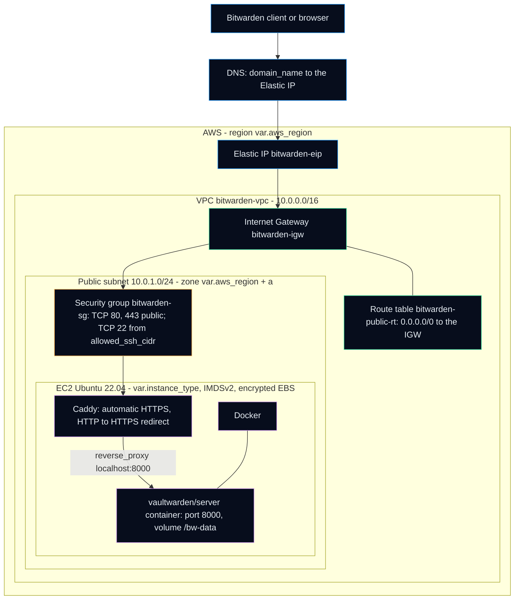

# Scripts-Déploiement-Vaultwarden

[](README.md)
[](README.en.md)

> **EN —** Terraform configuration that builds a VPC, a public subnet, a security group, an Ubuntu EC2 instance and an Elastic IP on AWS, then installs Docker, Vaultwarden and Caddy (automatic HTTPS) through `user_data`. This file is the English translation of the step-by-step guide; the original is in French ([README.md](README.md)).

## Folder contents

| File | Role |
|---|---|
| [`versions.tf`](versions.tf) | Minimum Terraform version, `hashicorp/aws` provider (~> 5.0) and provider region |
| [`variables.tf`](variables.tf) | Input variables (see the table below) |
| [`main.tf`](main.tf) | Resources: Ubuntu 22.04 AMI, VPC, public subnet, Internet Gateway, route table, network ACL, security group, EC2 instance (IMDSv2, encrypted volume) with its installation script, Elastic IP |
| [`outputs.tf`](outputs.tf) | Outputs: public IP (Elastic IP), HTTPS URL, instance ID, SSH command |
| [`terraform.tfvars.example`](terraform.tfvars.example) | Example values to copy into `terraform.tfvars` (file excluded from the repository) |

| Variable | Required | Default | Role |
|---|---|---|---|
| `aws_region` | No | `us-east-1` | AWS region; the subnet is placed in the `<region>a` zone |
| `domain_name` | **Yes** | — | Domain name served by Caddy, which must point to the Elastic IP |
| `allowed_ssh_cidr` | **Yes** | — | Only range allowed on port 22 (your address as a `/32`); `0.0.0.0/0` is rejected |
| `ssh_key_name` | No | `null` | Existing EC2 key pair; without it, no SSH connection |
| `instance_type` | No | `t2.micro` | Size of the EC2 instance |
| `vaultwarden_image` | No | `vaultwarden/server:1.37.4` | Docker image pinned to a precise version |

The reasons for each security choice are explained in the [repository README](../../README.en.md#security).

---

# Lab 3 – Vaultwarden deployment guide on AWS

**Author, purpose and planning**

| Item | Details |
| -------------- | ------------------------------- |
| **Referent** | Deployment guide for a **Vaultwarden** server (Bitwarden-compatible server written in Rust) hosted on **AWS** |
| **Sender** | **bazeeza and two teammates** |
| **Message** | Present and document a tutorial and the results of the deployment of the **Vaultwarden** server on AWS with the Terraform scripts. |
| **Receiver** | M. Jérémy Massinon |
| **Channel** | GitLab |
| **Code** | French (original), English (this translation) |
| **References** | [Vaultwarden](https://github.com/dani-garcia/vaultwarden) · [Terraform](https://developer.hashicorp.com/terraform/docs) · [AWS EC2 Docs](https://docs.aws.amazon.com/ec2/) · [AWS VPC Docs](https://docs.aws.amazon.com/vpc/) |

-----

#### Prerequisites

Before starting, you need:

- A working AWS account with the rights to create VPC, EC2, Elastic IP, etc.
- A domain name or a configured DNS zone
- An Ubuntu machine with Internet access
- The Terraform files of this folder (`versions.tf`, `variables.tf`, `main.tf`, `outputs.tf`), originally in the GitLab repository of the course

-----

### What is Vaultwarden?

First of all, **Vaultwarden** is a password manager (a *vault*) that securely keeps:

- passwords
- credentials
- secure notes
- other sensitive information that must be encrypted

It is an open-source server compatible with **Bitwarden**, simpler to configure, that we can install on our own server.

**This tool lets you:**

- Access your passwords from a web browser
- Store and encrypt passwords, secure notes, credentials, etc.
- Synchronize data between browsers, mobile and desktop applications
- Share items between several users (team)

In this lab, Vaultwarden is deployed on AWS with **Terraform** to automate the deployment.

-----

### Overall deployment diagram

The Terraform scripts that produce this deployment are in this folder (see [Folder contents](#folder-contents)). The diagram below shows the resources declared in `main.tf`:



Planning diagram drawn during the lab:

----


-----

### Phase 1 - Prepare the Ubuntu deployment machine

This phase prepares the machine that will run Terraform; it can be an Ubuntu machine.

#### Update the machine

```
sudo apt update && sudo apt upgrade -y
```
---

---

**Install the basic tools**
```
sudo apt install -y git curl unzip software-properties-common
```
**Install the AWS CLI**
```
sudo apt install -y awscli

# cmd pour vérifier la version installer
aws --version
```
---

---
**Configure the AWS credentials (the keys are given / created in the AWS console):**

**Option 1:**
```
aws configure
AWS Access Key ID: ***************
AWS Secret Access Key: ***************
Default region name: ca-central-1    # (prennez le meme de votre compte aws)
Default output format: json
```
------

------
**Configure the AWS credentials from the command line (the keys are given / created in the AWS console):**

**Option 2:**
```
nano ~/.aws/credentials
```
- Type your AWS credentials in the credentials file
```
AWS Access Key ID= ***************
AWS Secret Access Key= ***************
aws_session_token= *****************
Default region name= ********************
```
---

---
- The AWS credential information is found in this section of your AWS account
----

----

#### Install Terraform

```
curl -fsSL https://apt.releases.hashicorp.com/gpg | \
sudo gpg --dearmor -o /usr/share/keyrings/hashicorp-archive-keyring.gpg

echo "deb [signed-by=/usr/share/keyrings/hashicorp-archive-keyring.gpg] \
https://apt.releases.hashicorp.com $(lsb_release -cs) main" | \
sudo tee /etc/apt/sources.list.d/hashicorp.list

sudo apt update
sudo apt install -y terraform

# CMD pour vérifier la version installer
terraform -version
```
---

---

The comments inside the code blocks are kept as in the original French guide: `# cmd pour vérifier la version installer` means "command to check the installed version", and `# (prennez le meme de votre compte aws)` means "use the same region as your AWS account".

### Phase 2 - Initialization

This phase copies the scripts, then starts the deployment from the Terraform scripts already present in the repository.

1. **Get the `.tf` files of this folder (clone the repository or copy them)**
2. **Open the Ubuntu terminal and create the Terraform folder**
3. **Create each file and paste the content of the Terraform scripts into it**
```
cd ~/terraform
```
**or**
```
mkdir ~/terraform
```
---

---

**Fill in the variables**: copy the example, then replace `domain_name` with your domain name and `allowed_ssh_cidr` with your public address as a `/32` (add `ssh_key_name` if you want to connect with SSH). The `terraform.tfvars` file is excluded from the repository by the `.gitignore`.
```
cp terraform.tfvars.example terraform.tfvars
nano terraform.tfvars
```

**Initialize Terraform**: this command downloads the plugins (the AWS provider and everything else needed) and prepares the folder.
```
terraform init
```
---

---

**Deployment plan**

```
terraform plan
```

This command:

* reads the Terraform scripts in the folder,
* shows what will be created (VPC, EC2, etc.),
* saves the plan in the folder

---

**Apply the plan, which starts the deployment**

```
terraform apply
```
Terraform will then:

* create the VPC, the subnet, the Internet Gateway
* create the security group
* create the Ubuntu EC2 instance
* run the Vaultwarden installation script on this instance

---

---
**At the end, Terraform shows the defined **outputs**:**

* The public IP address of the instance
* The DNS name or the URL of the server
* The instance ID
---

---
**Then go to the duckdns.org provider web page and create an account to point the public IP address to our domain name**
- Here is a screenshot of the expected result:
----

----

**WARNING!**
**WARNING!**
**The DESTROY command destroys and deletes the infrastructure created** (including the Vaultwarden vault: see [Costs and teardown](../../README.en.md#costs-and-teardown))

```
terraform destroy
```
---

---

### Phase 3 - Functional tests

> [!NOTE]
> The AWS identifiers (`vpc-…`, `subnet-…`, `sg-…`, `i-…`), the public IP address and the domain name of the lab have been replaced by generic values between `< >`. These values only apply to one deployment: every new deployment produces its own values (see the `terraform output` outputs).
>
> This phase describes the deployment as it was tested during the lab: port 22 was then open to everyone. The current code limits SSH to `allowed_ssh_cidr`, requires IMDSv2 and encrypts the volume; these changes have not been redeployed yet for new screenshots.

**VPC configuration**

* **VPC**: `<vpc-id>` (`bitwarden-vpc`)
* **IPv4 CIDR**: `10.0.0.0/16`
* **Public subnet**: `<subnet-id>` (`bitwarden-public-subnet`) in **us-east-1a**
* **Internet Gateway**: `bitwarden-igw` attached to the VPC
* **Public route table**: `bitwarden-public-rt` with a `0.0.0.0/0` route to the Internet Gateway
* **Security group attached to the instance**: `<sg-id>` (`bitwarden-sg`)
------
- In short
- Internet = to ports 80/443 of **bitwarden-sg**
- Caddy web server on the EC2 instance = to the **Vaultwarden** container
---

-----
**Vaultwarden EC2 instance**

* **Instance name**: `Vaultwarden-Server`
* **Instance ID**: `<instance-id>`
* **Region / Availability Zone**: `us-east-1` – `us-east-1a`
* **EC2 instance type**: `t2.micro`
* **VPC**: `<vpc-id>` (`bitwarden-vpc`)
* **Subnet**: `<subnet-id>` (`bitwarden-public-subnet`)
* **Private IP address**: an address from `10.0.1.0/24` assigned by AWS
* **Public IPv4 address / Elastic IP**: `<elastic-ip>` (`bitwarden-eip`)
* **EC2 public DNS**: `ec2-<elastic-ip>.compute-1.amazonaws.com`
* **Domain name used for the application**: `<domain_name>` (DuckDNS, points to `<elastic-ip>`)
* **Attached security group**: `<sg-id>` (`bitwarden-sg`)
* **Publicly exposed ports**:
  * **22/TCP**: SSH (administration)
  * **80/TCP**: HTTP (redirect to HTTPS by Caddy)
  * **443/TCP**: HTTPS (secure access to the Vaultwarden site)
----

----
* **Attached security group**: `<sg-id>` (`bitwarden-sg`)
----

----

### Phase 4 - Validation

- Expected result: **Web page over HTTPS with the domain name**
----

---

---
- Expected result: **Account creation to check the features**
----

-----
