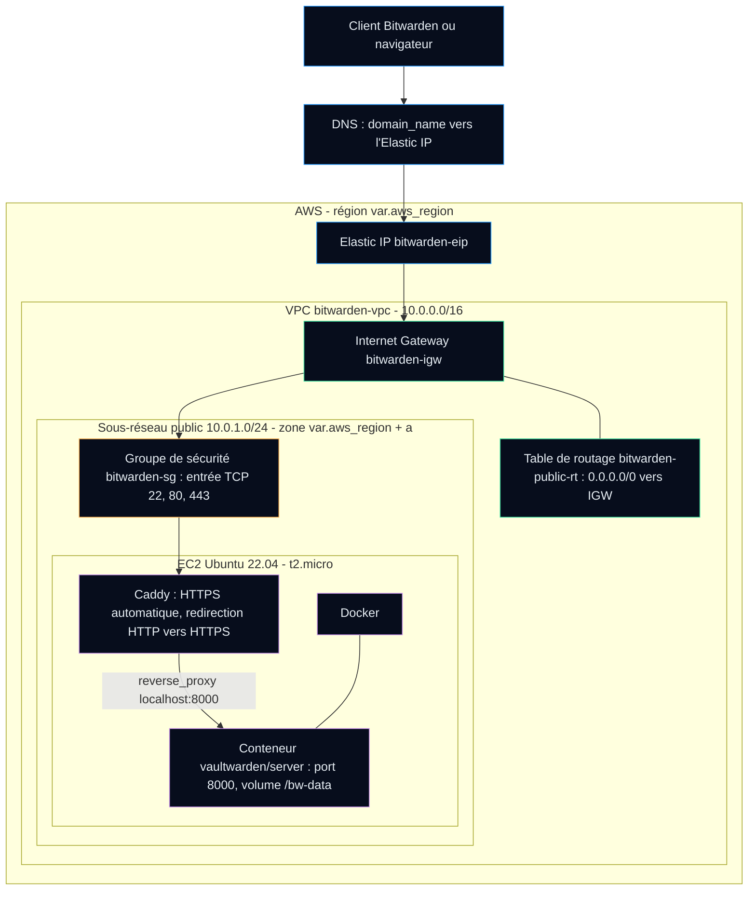

# Scripts-Déploiement-Vaultwarden

> **EN —** Terraform configuration that builds a VPC, a public subnet, a security group, an Ubuntu EC2 instance and an Elastic IP on AWS, then installs Docker, Vaultwarden and Caddy (automatic HTTPS) through `user_data`. The step-by-step guide below is in French.

## Contenu du dossier

| Fichier | Rôle |
|---|---|
| [`versions.tf`](versions.tf) | Version minimale de Terraform, fournisseur `hashicorp/aws` (~> 5.0) et région du fournisseur |
| [`variables.tf`](variables.tf) | Variables d'entrée : `aws_region` (défaut `us-east-1`) et `domain_name` (obligatoire) |
| [`main.tf`](main.tf) | Ressources : AMI Ubuntu 22.04, VPC, sous-réseau public, passerelle Internet, table de routage, ACL réseau, groupe de sécurité, instance EC2 avec script d'installation, Elastic IP |
| [`outputs.tf`](outputs.tf) | Sorties : IP publique (Elastic IP), URL HTTPS, ID de l'instance |
| [`terraform.tfvars.example`](terraform.tfvars.example) | Exemple de valeurs à copier dans `terraform.tfvars` (fichier exclu du dépôt) |

---

# Travail Pratique 3 – Guide de déploiement Vaultwarden sur AWS
**Auteur, but et planification**

| Élément        | Contenu                         |
| -------------- | ------------------------------- |
| **Référent**   | Guide de déploiement d’un serveur **Vaultwarden** (serveur compatible Bitwarden écrit en Rust) hébergé sur **AWS** |
| **Émetteur**   | **Bariu Azeez – Abdul-Majid – Aran** |
| **Message**    | Présenter/documenter un tutoriel et les résultats du déploiement du serveur **Vaultwarden** sur AWS à l’aide des scripts Terraform.  |
| **Récepteur**  | M. Jérémy Massinon  |
| **Canal**      | GitLab |
| **Code**       | Français |
| **Références** | [Vaultwarden](https://github.com/dani-garcia/vaultwarden) · [Terraform](https://developer.hashicorp.com/terraform/docs) · [AWS EC2 Docs](https://docs.aws.amazon.com/fr_fr/ec2/) · [AWS VPC Docs](https://docs.aws.amazon.com/vpc/) · |

-----

#### Prérequis

Avant de commencer, il faut :

- Un compte AWS functionelle avec les droits pour créer VPC, EC2, Elastic IP, etc.
- Un nom de domaine ou une zone DNS configuré
- Une machine Ubuntu avec accès Internet
- Les fichiers Terraform de ce dossier (`versions.tf`, `variables.tf`, `main.tf`, `outputs.tf`), à l'origine dans le dépôt GitLab du cours

-----

### C’est quoi Vaultwarden ?

 D’abord, **Vaultwarden** est un gestionnaire de mots de passe (un *vault*) qui permet de garder de façon sécurisée :

- des mots de passe  
- des identifiants  
- des notes sécurisées  
- d’autres informations sensibles qui doivent être chiffrées  

C’est un serveur compatible avec **Bitwarden** type open-source et aussi plus simple à configurer et on peut l’installer sur notre propre serveur.

**Cet outil permet de :**

- Accéder à ses mots de passe depuis un navigateur web
- Stocker et chiffrer des mots de passe, notes sécurisées, identifiants, etc.
- Synchroniser les données entre navigateurs, applications mobiles et de bureau
- Partager des éléments entre plusieurs utilisateurs (équipe)

Dans le cadre de ce travail pratique, on déploie Vaultwarden sur AWS à l’aide de **Terraform** pour faire un déploiement automatsée.

-----

### Schéma globale du Déploiement

Les scripts Terraform qui produisent ce déploiement sont dans ce dossier (voir [Contenu du dossier](#contenu-du-dossier)). Le schéma ci-dessous reprend les ressources déclarées dans `main.tf` :



Schéma de planification réalisé pendant le travail pratique :

----
  

-----
### Phase 1 - Préparer la machine Ubuntu de déploiement

Cette phase sert à préparer votre machine qui va lancer Terraform ça peut être un Ubuntu.


#### Mettre à jour la machine
```
sudo apt update && sudo apt upgrade -y
```
---
  
---

**Installer les outils de base**
```
sudo apt install -y git curl unzip software-properties-common
```
**Installer AWS CLI**
```
sudo apt install -y awscli

# cmd pour vérifier la version installer
aws --version
```
---
  
---
**Configurer les identifiants AWS (les clés sont données / créées dans la console AWS) :**

**Option 1:**: 
```
aws configure
AWS Access Key ID: ***************
AWS Secret Access Key: ***************
Default region name: ca-central-1    # (prennez le meme de votre compte aws)
Default output format: json
```
------
  
------
**Configurer les identifiants AWS en ligne de commande (les clés sont données / créées dans la console AWS) :**

**Option 2:** 
```
nano ~/.aws/credentials
```
- Tapez vos identifiants AWS dans le fichier credentials
```
AWS Access Key ID= ***************
AWS Secret Access Key= ***************
aws_session_token= *****************
Default region name= ********************
```
---
  
---
- Les informations des identifiants AWS s'est trouve dans cette section de votre compte AWS
----
  
----

#### Installer Terraform

```
curl -fsSL https://apt.releases.hashicorp.com/gpg | \
sudo gpg --dearmor -o /usr/share/keyrings/hashicorp-archive-keyring.gpg

echo "deb [signed-by=/usr/share/keyrings/hashicorp-archive-keyring.gpg] \
https://apt.releases.hashicorp.com $(lsb_release -cs) main" | \
sudo tee /etc/apt/sources.list.d/hashicorp.list

sudo apt update
sudo apt install -y terraform

# CMD pour vérifier la version installer
terraform -version
```
---
  
---

### Phase 2 - Initialisation

Donc ici cette phase sert à copier les script et par la suite lancer le déploiement à partir des scripts Terraform déjà présents dans le repotoire.

1. **Récupérer les fichiers `.tf` de ce dossier (clonage du dépôt ou copie)**
2. **Aller dans le terminal de ubuntu et créer le dossier Terraform**
3. **Créer et coller dans chaque fichier créer les éléments du scripts-terraform**
```
cd ~/terraform
```
**ou bien**
```
mkdir ~/terraform
```
---
  
---

**Renseigner les variables** : copier l'exemple puis remplacer `domain_name` par votre nom de domaine. Le fichier `terraform.tfvars` est exclu du dépôt par le `.gitignore`.
```
cp terraform.tfvars.example terraform.tfvars
nano terraform.tfvars
```

**Initialiser Terraform** : Cette commande télécharge les plugins soit chez AWS ou bien tout ce qui est nécessaire et prépare le dossier.
```
terraform init
```
---
  
---

**Plan de déploiement**

```
terraform plan
```

Cette commande :

* lit les scripts Terraform dans le dossier,
* montre ce qui va être créé (VPC, EC2, etc.),
* enregistre le plan dans le dossier

---

**Appliquer le plan et par la suit elle lancer le déploiement**

```
terraform apply
```
Terraform va alors :

* créer le VPC, le subnet, l’Internet Gateway
* créer le groupe de sécurité
* créer l’instance EC2 Ubuntu
* exécuter le script d’installation de Vaultwarden sur cette instance

---
  
---
**À la fin, Terraform affiche des **outputs** définis :**

* L’adresse IP publique de l’instance
* Le nom DNS ou bien le url du serveur
* L'id de instance
---
  
---
**Ensuite, allez à la page web du fourniseur duckdns.org et créer vous un compte afin de réattribuer l'addresse ip public à notre nom de domaine**
- Voici la capture du résultat attendu:
----
  
----

**ATTENTION!**
**ATTENTION!**
**La commande DESTROY détruire et supprime l’infrastructure créer**

```
terraform destroy
```
---
  
---

### Phase 3 - Tests de fonctionnement

> [!NOTE]
> Les identifiants AWS (`vpc-…`, `subnet-…`, `sg-…`, `i-…`), l'adresse IP publique et le nom de domaine du laboratoire ont été remplacés par des valeurs génériques entre `< >`. Ces valeurs ne servent qu'à un déploiement donné : chaque nouveau déploiement produit ses propres valeurs (voir les sorties `terraform output`).

**Configuration du VPC**

* **VPC** : `<vpc-id>` (`bitwarden-vpc`)
* **CIDR IPv4** : `10.0.0.0/16`
* **Sous-réseau public** : `<subnet-id>` (`bitwarden-public-subnet`) en **us-east-1a**
* **Passerelle Internet** : `bitwarden-igw` reliée au VPC
* **Table de routage publique** : `bitwarden-public-rt` avec une route `0.0.0.0/0` vers l’Internet Gateway
* **Groupe de sécurité associé à l’instance** : `<sg-id>` (`bitwarden-sg`)
------
- En Bref
- Internet = vers ports 80/443 du **bitwarden-sg**
- Serveur web Caddy sur l’EC2 = vers conteneur **Vaultwarden**
---

-----
**Instance EC2 Vaultwarden**

* **Nom de l’instance** : `Vaultwarden-Server`
* **ID de l’instance** : `<instance-id>`
* **Région / Zone de dispo** : `us-east-1` – `us-east-1a`
* **Type d’instance EC2** : `t2.micro`
* **VPC** : `<vpc-id>` (`bitwarden-vpc`)
* **Sous-réseau** : `<subnet-id>` (`bitwarden-public-subnet`)
* **Adresse IP privée** : une adresse de `10.0.1.0/24` attribuée par AWS
* **Adresse IPv4 publique / Elastic IP** : `<elastic-ip>` (`bitwarden-eip`)
* **DNS public EC2** : `ec2-<elastic-ip>.compute-1.amazonaws.com`
* **Nom de domaine utilisé pour l’appli** : `<domain_name>` (DuckDNS, pointe vers `<elastic-ip>`)
* **Groupe de sécurité attaché** : `<sg-id>` (`bitwarden-sg`)
* **Ports exposés publiquement** :
  * **22/TCP** : SSH (administration)
  * **80/TCP** : HTTP (redirection vers HTTPS par Caddy)
  * **443/TCP** : HTTPS (accès sécurisé au site Vaultwarden)
----
  
----
* **Groupe de sécurité attaché** : `<sg-id>` (`bitwarden-sg`)
----
  
----

### Phase 4 - Validation

- Résultats Attendu: **Page web en https et avec nom de domaine**
----
  
---
  
---
- Résultats Attendu: **Création d'un compte pour vérifier les fonctionnalités**
----
  
-----
