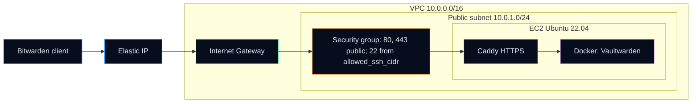

# AutomationHub

[](README.md)
[](README.en.md)


[](https://github.com/Bazeeza/AutomationHub/actions/workflows/terraform.yml)
[](https://github.com/Bazeeza/AutomationHub/actions/workflows/links.yml)

## Summary (English)

AutomationHub is a college infrastructure-as-code project: one `terraform apply` builds a small AWS network (VPC, public subnet, Internet Gateway, security group), launches an Ubuntu EC2 instance with a fixed Elastic IP, and installs **Vaultwarden** (a lightweight Bitwarden-compatible password manager) in Docker behind **Caddy** for automatic HTTPS. The working configuration and the step-by-step lab guide are in [`AWS-Scripts-Terraform/Scripts-Déploiement-Vaultwarden/`](AWS-Scripts-Terraform/Scripts-Déploiement-Vaultwarden/) ([English version of the guide](AWS-Scripts-Terraform/Scripts-Déploiement-Vaultwarden/README.en.md)).

**Skills shown:** Terraform (providers, validated variables, outputs), AWS networking (VPC, routing, security groups, Elastic IP), EC2 hardening (SSH restricted to one CIDR, IMDSv2, encrypted EBS), cloud-init style provisioning with `user_data`, Docker, reverse proxy and TLS, CI with GitHub Actions (`terraform fmt`, `validate`, link check), secret hygiene in git (`.gitignore`, `tfvars.example`).

---

## Project overview

Automated deployment of a **Vaultwarden** server on AWS with **Terraform** and **Docker**, built as a team for the DEC in Computer Science Technology (networking).

| Item | Details |
|---|---|
| **Subject** | Deployment guide for a **Vaultwarden** server (Bitwarden-compatible password manager, written in Rust) hosted on AWS |
| **Team** | bazeeza and two teammates |
| **Goal** | Document the complete deployment of the Vaultwarden server on AWS with Terraform scripts, then present the results |
| **Context** | DEC in Computer Science Technology (networking) |
| **Technologies** | Terraform, AWS (VPC, EC2, Elastic IP, security groups), Docker, Caddy, Ubuntu Server 22.04, Vaultwarden, GitHub Actions |
| **Level** | Intermediate |
| **Contents** | Complete Terraform configuration, step-by-step lab guide (French original, English translation), GitHub Actions CI (`terraform fmt`, `validate`, links) |
| **Status** | Completed (lab submitted); the code was hardened after submission and has not been redeployed yet (see the note in the guide, phase 3) |
| **Start here** | [Vaultwarden guide](AWS-Scripts-Terraform/Scripts-Déploiement-Vaultwarden/README.en.md) |

---

## Architecture



The detailed diagram (route table, ports, volume) is in the [Vaultwarden guide](AWS-Scripts-Terraform/Scripts-Déploiement-Vaultwarden/README.en.md#overall-deployment-diagram).

---

## Repository contents

```text
AutomationHub/
├── .github/workflows/
│   ├── links.yml                       # CI: relative links of the Markdown files
│   └── terraform.yml                   # CI: terraform fmt -check, init, validate
├── .gitignore                          # Excludes *.tfstate, *.tfvars, .terraform/
├── README.md                           # French version
├── README.en.md                        # English version (this file)
├── AWS-Scripts-Terraform/
│   ├── README.md
│   ├── README.en.md
│   ├── Scripts-Déploiement-MMA/        # Reserved: README only
│   │   ├── README.md
│   │   └── README.en.md
│   └── Scripts-Déploiement-Vaultwarden/
│       ├── README.md                   # Step-by-step lab guide (French)
│       ├── README.en.md                # Step-by-step lab guide (English)
│       ├── main.tf                     # VPC, subnet, SG, EC2 + user_data, Elastic IP
│       ├── outputs.tf                  # Public IP, URL, instance ID, SSH command
│       ├── terraform.tfvars.example    # Example values to copy
│       ├── variables.tf                # Region, domain, instance type, image, SSH
│       └── versions.tf                 # Terraform >= 1.0, AWS provider ~> 5.0
└── DOCKER-Scripts-Terraform/           # Reserved: README only
    ├── README.md
    └── README.en.md
```

| Folder | Actual role |
|---|---|
| [`AWS-Scripts-Terraform/Scripts-Déploiement-Vaultwarden/`](AWS-Scripts-Terraform/Scripts-Déploiement-Vaultwarden/README.en.md) | Complete Terraform configuration and lab guide |
| [`AWS-Scripts-Terraform/Scripts-Déploiement-MMA/`](AWS-Scripts-Terraform/Scripts-Déploiement-MMA/README.en.md) | Reserved folder, no script |
| [`DOCKER-Scripts-Terraform/`](DOCKER-Scripts-Terraform/README.en.md) | Reserved folder, no script: Docker is installed by the `user_data` of `main.tf` |

---

## What is Vaultwarden?

Vaultwarden is a self-hosted password manager, compatible with the Bitwarden clients. It stores credentials, secure notes and other sensitive information encrypted. Written in Rust, it is much lighter than the official Bitwarden server, which suits a small cloud instance.

---

## Prerequisites

- An **AWS account** with the rights to create VPC, EC2 and Elastic IP resources
- A **domain name** (for example a DuckDNS subdomain) that you can point to the Elastic IP
- **Terraform** 1.0 or later
- The **AWS CLI** configured with your credentials (`aws configure`)

---

## Deployment

```bash
# 1. Cloner le dépôt et entrer dans le module Terraform
git clone https://github.com/Bazeeza/AutomationHub.git
cd AutomationHub/AWS-Scripts-Terraform/Scripts-Déploiement-Vaultwarden

# 2. Renseigner les variables (fichier exclu du dépôt) :
#    domain_name et allowed_ssh_cidr (votre adresse publique en /32) sont obligatoires
cp terraform.tfvars.example terraform.tfvars

# 3. Initialiser, vérifier le plan, appliquer
terraform init
terraform plan
terraform apply

# 4. Lire les sorties : IP publique, URL, ID d'instance
terraform output
```

The comments in this block are kept as in the original. In short: 1. clone the repository and enter the Terraform module; 2. fill in the variables (`domain_name` and `allowed_ssh_cidr`, your public address as a `/32`, are required; the file is excluded from the repository); 3. initialize, review the plan, apply; 4. read the outputs: public IP, URL, instance ID.

Then point `domain_name` to the IP shown by `bitwarden_public_ip`: Caddy then obtains the HTTPS certificate automatically.

Once the lab is over, follow the [Costs and teardown](#costs-and-teardown) section.

---

## Costs and teardown

What this deployment makes AWS bill while it exists:

| Resource | Billing |
|---|---|
| EC2 instance (`instance_type`, `t2.micro` by default) | Per hour, while the instance runs (unless the account has credits or the free tier) |
| Root EBS volume | Per GB per month, **even when the instance is stopped** |
| Elastic IP | Every public IPv4 address is billed per hour since February 2024, attached or not |
| VPC, subnet, Internet Gateway, security group | No direct cost |

Stopping the instance is therefore not enough: the volume and the Elastic IP keep costing. To remove everything:

```bash
cd AutomationHub/AWS-Scripts-Terraform/Scripts-Déploiement-Vaultwarden

# 1. Voir ce qui sera détruit (aucune modification)
terraform plan -destroy

# 2. Détruire toutes les ressources gérées par l'état local
terraform destroy

# 3. Vérifier qu'il ne reste rien dans l'état
terraform state list
```

The comments are kept as in the original: 1. see what will be destroyed (no change); 2. destroy every resource managed by the local state; 3. check that nothing is left in the state.

> [!WARNING]
> `terraform destroy` also deletes the EBS volume (`delete_on_termination = true`), so **the Vaultwarden vault and every password it holds**. Export the vault from the Bitwarden client before destroying.

After the teardown: delete the DNS record (for example the DuckDNS subdomain) that pointed to the old Elastic IP, because that address will be given to another AWS customer.

References: [Amazon VPC pricing, public IPv4 addresses](https://aws.amazon.com/vpc/pricing/) · [Amazon EBS pricing](https://aws.amazon.com/ebs/pricing/) · [`terraform destroy`](https://developer.hashicorp.com/terraform/cli/commands/destroy)

---

## Security

> [!IMPORTANT]
> No credential, access key or password may be written in the files of the repository.
>
> - `terraform.tfvars` and the `*.tfstate` state files are excluded by the [`.gitignore`](.gitignore): the state holds the resource IDs, the IP addresses and sometimes secrets in clear text.
> - AWS credentials stay in `~/.aws/credentials` or in environment variables.

Security choices applied in [`main.tf`](AWS-Scripts-Terraform/Scripts-Déploiement-Vaultwarden/main.tf):

| Measure | Code | Why |
|---|---|---|
| **Restricted SSH** | `cidr_blocks = [var.allowed_ssh_cidr]` | Least network access: only the administration workstation (ideally a `/32` address) can attempt an SSH connection. A validation rejects `0.0.0.0/0`, which would expose port 22 to the brute-force robots of the Internet. |
| **Public web** | Ports 80 and 443 open to `0.0.0.0/0` | Required: the Bitwarden clients must reach the service, and Let's Encrypt must reach Caddy to issue the certificate. Port 80 only redirects to HTTPS. |
| **IMDSv2 required** | `metadata_options { http_tokens = "required" }` | The metadata service (`169.254.169.254`) only accepts requests that carry a session token obtained with `PUT`. An SSRF flaw in a web application, which can only send `GET` requests, can therefore no longer read the instance metadata. |
| **Hop limit = 1** | `http_put_response_hop_limit = 1` | The IMDSv2 token does not cross the Docker network bridge: the Vaultwarden container, which does not need it, cannot query the metadata. |
| **Encrypted volume** | `root_block_device { encrypted = true }` | The disk holds `/bw-data`, the database of the password vault. It is encrypted at rest with the AWS managed key (`aws/ebs`), and so are its snapshots. |
| **Container on localhost only** | `-p 127.0.0.1:8000:8000` | Vaultwarden only listens on the loopback: only Caddy, on the same instance, can reach it. Docker writes its own iptables rules and bypasses UFW, which is why the port must not be published on every interface. |
| **Pinned image** | `vaultwarden_image = "vaultwarden/server:1.37.4"` | With `:latest`, two deployments of the same code can install different versions. A fixed version makes the deployment reproducible; an update becomes a deliberate, traceable change. |
| **Optional SSH key** | `key_name = var.ssh_key_name` | By default (`null`), no key is installed and no SSH connection is possible: the attack surface stays minimal until the instance needs administration. |

> [!NOTE]
> Known limits, left as they are to stay faithful to the lab: the network ACL of the subnet allows all traffic (filtering relies on the security group, which is *stateful*), and the UFW firewall of the instance is not enabled by the `user_data` (its `ufw allow` rules therefore have no effect).
>
> References: [IMDSv2 (AWS)](https://docs.aws.amazon.com/AWSEC2/latest/UserGuide/configuring-instance-metadata-service.html) · [EBS encryption (AWS)](https://docs.aws.amazon.com/ebs/latest/userguide/ebs-encryption.html) · [`aws_instance` (Terraform registry)](https://registry.terraform.io/providers/hashicorp/aws/latest/docs/resources/instance)

---

## Technologies used

`Terraform` · `AWS (VPC, EC2, Elastic IP, Security Groups)` · `Docker` · `Caddy` · `Ubuntu Server 22.04` · `Vaultwarden`

---

## Author

**bazeeza** — graduating student of the DEC in Computer Science Technology (networking) · Montréal, QC
GitHub: [@Bazeeza](https://github.com/Bazeeza) · Contact: info@bazeeza.ca
