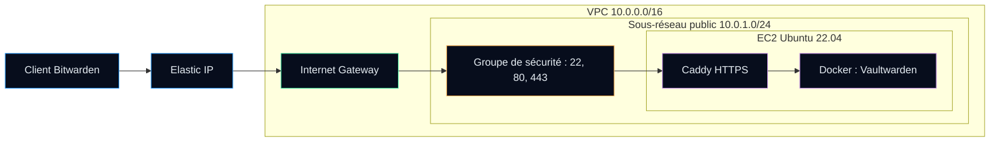

# AutomationHub


## Summary (English)

AutomationHub is a college infrastructure-as-code project: one `terraform apply` builds a small AWS network (VPC, public subnet, Internet Gateway, security group), launches an Ubuntu EC2 instance with a fixed Elastic IP, and installs **Vaultwarden** (a lightweight Bitwarden-compatible password manager) in Docker behind **Caddy** for automatic HTTPS. The working configuration and the step-by-step lab guide (in French) are in [`AWS-Scripts-Terraform/Scripts-Déploiement-Vaultwarden/`](AWS-Scripts-Terraform/Scripts-Déploiement-Vaultwarden/).

**Skills shown:** Terraform (providers, variables, outputs), AWS networking (VPC, routing, security groups, Elastic IP), cloud-init style provisioning with `user_data`, Docker, reverse proxy and TLS, secret hygiene in git (`.gitignore`, `tfvars.example`).

---

## Version française

Déploiement automatisé d'un serveur **Vaultwarden** sur AWS avec **Terraform** et **Docker**, réalisé en équipe dans le cadre du DEC en Techniques de l'informatique (réseautique) au Collège de Rosemont.

| Élément | Contenu |
|---|---|
| **Objet** | Guide de déploiement d'un serveur **Vaultwarden** (gestionnaire de mots de passe compatible Bitwarden, écrit en Rust) hébergé sur AWS |
| **Équipe** | Bariu Azeez · Abdul-Majid · Aran |
| **Objectif** | Documenter le déploiement complet du serveur Vaultwarden sur AWS au moyen de scripts Terraform, puis présenter les résultats obtenus |
| **Cadre** | DEC en Techniques de l'informatique (réseautique), Collège de Rosemont |

---

## Architecture



Le schéma détaillé (table de routage, ports, volume) est dans le [guide Vaultwarden](AWS-Scripts-Terraform/Scripts-Déploiement-Vaultwarden/README.md#schéma-globale-du-déploiement).

---

## Contenu du dépôt

```
AutomationHub/
├── .gitignore                          # Exclut *.tfstate, *.tfvars, .terraform/
├── README.md
├── AWS-Scripts-Terraform/
│   ├── README.md
│   ├── Scripts-Déploiement-MMA/        # Réservé : README seulement
│   │   └── README.md
│   └── Scripts-Déploiement-Vaultwarden/
│       ├── README.md                   # Guide pas à pas du TP (français)
│       ├── main.tf                     # VPC, sous-réseau, SG, EC2 + user_data, Elastic IP
│       ├── outputs.tf                  # IP publique, URL, ID d'instance
│       ├── terraform.tfvars.example    # Valeurs d'exemple à copier
│       ├── variables.tf                # aws_region, domain_name
│       └── versions.tf                 # Terraform >= 1.0, fournisseur AWS ~> 5.0
└── DOCKER-Scripts-Terraform/           # Réservé : README seulement
    └── README.md
```

| Dossier | Rôle réel |
|---|---|
| [`AWS-Scripts-Terraform/Scripts-Déploiement-Vaultwarden/`](AWS-Scripts-Terraform/Scripts-Déploiement-Vaultwarden/) | Configuration Terraform complète et guide du TP |
| [`AWS-Scripts-Terraform/Scripts-Déploiement-MMA/`](AWS-Scripts-Terraform/Scripts-Déploiement-MMA/) | Dossier réservé, aucun script |
| [`DOCKER-Scripts-Terraform/`](DOCKER-Scripts-Terraform/) | Dossier réservé, aucun script : Docker est installé par le `user_data` de `main.tf` |

---

## Qu'est-ce que Vaultwarden ?

Vaultwarden est un gestionnaire de mots de passe auto-hébergé, compatible avec les clients Bitwarden. Il permet de conserver de façon chiffrée des identifiants, des notes sécurisées et d'autres informations sensibles. Écrit en Rust, il est nettement plus léger que le serveur Bitwarden officiel, ce qui convient à une petite instance cloud.

---

## Prérequis

- Un **compte AWS** avec les droits pour créer des ressources VPC, EC2 et Elastic IP
- Un **nom de domaine** (par exemple un sous-domaine DuckDNS) que vous pourrez faire pointer vers l'Elastic IP
- **Terraform** 1.0 ou plus récent
- L'**AWS CLI** configurée avec vos identifiants (`aws configure`)

---

## Déploiement

```bash
# 1. Cloner le dépôt et entrer dans le module Terraform
git clone https://github.com/Bazeeza/AutomationHub.git
cd AutomationHub/AWS-Scripts-Terraform/Scripts-Déploiement-Vaultwarden

# 2. Renseigner les variables (fichier exclu du dépôt)
cp terraform.tfvars.example terraform.tfvars

# 3. Initialiser, vérifier le plan, appliquer
terraform init
terraform plan
terraform apply

# 4. Lire les sorties : IP publique, URL, ID d'instance
terraform output
```

Faites ensuite pointer `domain_name` vers l'IP affichée par `bitwarden_public_ip` : Caddy obtient alors le certificat HTTPS automatiquement.

**Nettoyage :** `terraform destroy` supprime toutes les ressources créées (dont l'Elastic IP, facturée tant qu'elle existe).

---

## Sécurité

> [!IMPORTANT]
> Aucun identifiant, clé d'accès ou mot de passe ne doit être inscrit dans les fichiers du dépôt.
>
> - `terraform.tfvars` et les fichiers d'état `*.tfstate` sont exclus par le [`.gitignore`](.gitignore) : l'état contient les ID de ressources, les IP et parfois des secrets en clair.
> - Les identifiants AWS restent dans `~/.aws/credentials` ou dans des variables d'environnement.

> [!WARNING]
> Dans la version actuelle, le port SSH (22) est ouvert à `0.0.0.0/0` dans le groupe de sécurité. C'était acceptable pour un laboratoire de courte durée ; à restreindre à votre propre adresse avant tout usage réel.

---

## Technologies utilisées

`Terraform` · `AWS (VPC, EC2, Elastic IP, Security Groups)` · `Docker` · `Caddy` · `Ubuntu Server 22.04` · `Vaultwarden`

---

## Auteur

**Bariu Azeez** — finissant du DEC Techniques de l'informatique (réseautique), Collège de Rosemont · Montréal, QC
GitHub : [@Bazeeza](https://github.com/Bazeeza) · Contact : Azeez@bazeeza.ca
