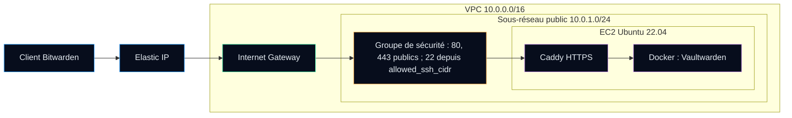

# AutomationHub


[](https://github.com/Bazeeza/AutomationHub/actions/workflows/terraform.yml)
[](https://github.com/Bazeeza/AutomationHub/actions/workflows/links.yml)

## Summary (English)

AutomationHub is a college infrastructure-as-code project: one `terraform apply` builds a small AWS network (VPC, public subnet, Internet Gateway, security group), launches an Ubuntu EC2 instance with a fixed Elastic IP, and installs **Vaultwarden** (a lightweight Bitwarden-compatible password manager) in Docker behind **Caddy** for automatic HTTPS. The working configuration and the step-by-step lab guide (in French) are in [`AWS-Scripts-Terraform/Scripts-Déploiement-Vaultwarden/`](AWS-Scripts-Terraform/Scripts-Déploiement-Vaultwarden/).

**Skills shown:** Terraform (providers, validated variables, outputs), AWS networking (VPC, routing, security groups, Elastic IP), EC2 hardening (SSH restricted to one CIDR, IMDSv2, encrypted EBS), cloud-init style provisioning with `user_data`, Docker, reverse proxy and TLS, CI with GitHub Actions (`terraform fmt`, `validate`, link check), secret hygiene in git (`.gitignore`, `tfvars.example`).

---

## Version française

Déploiement automatisé d'un serveur **Vaultwarden** sur AWS avec **Terraform** et **Docker**, réalisé en équipe dans le cadre du DEC en Techniques de l'informatique (réseautique) au Collège de Rosemont.

| Élément | Contenu |
|---|---|
| **Objet** | Guide de déploiement d'un serveur **Vaultwarden** (gestionnaire de mots de passe compatible Bitwarden, écrit en Rust) hébergé sur AWS |
| **Équipe** | Bariu Azeez · Abdul-Majid · Aran |
| **Objectif** | Documenter le déploiement complet du serveur Vaultwarden sur AWS au moyen de scripts Terraform, puis présenter les résultats obtenus |
| **Cadre** | DEC en Techniques de l'informatique (réseautique), Collège de Rosemont |

---

## Architecture



Le schéma détaillé (table de routage, ports, volume) est dans le [guide Vaultwarden](AWS-Scripts-Terraform/Scripts-Déploiement-Vaultwarden/README.md#schéma-globale-du-déploiement).

---

## Contenu du dépôt

```
AutomationHub/
├── .github/workflows/
│   ├── links.yml                       # CI : liens relatifs des fichiers Markdown
│   └── terraform.yml                   # CI : terraform fmt -check, init, validate
├── .gitignore                          # Exclut *.tfstate, *.tfvars, .terraform/
├── README.md
├── AWS-Scripts-Terraform/
│   ├── README.md
│   ├── Scripts-Déploiement-MMA/        # Réservé : README seulement
│   │   └── README.md
│   └── Scripts-Déploiement-Vaultwarden/
│       ├── README.md                   # Guide pas à pas du TP (français)
│       ├── main.tf                     # VPC, sous-réseau, SG, EC2 + user_data, Elastic IP
│       ├── outputs.tf                  # IP publique, URL, ID d'instance, commande SSH
│       ├── terraform.tfvars.example    # Valeurs d'exemple à copier
│       ├── variables.tf                # Région, domaine, type d'instance, image, SSH
│       └── versions.tf                 # Terraform >= 1.0, fournisseur AWS ~> 5.0
└── DOCKER-Scripts-Terraform/           # Réservé : README seulement
    └── README.md
```

| Dossier | Rôle réel |
|---|---|
| [`AWS-Scripts-Terraform/Scripts-Déploiement-Vaultwarden/`](AWS-Scripts-Terraform/Scripts-Déploiement-Vaultwarden/) | Configuration Terraform complète et guide du TP |
| [`AWS-Scripts-Terraform/Scripts-Déploiement-MMA/`](AWS-Scripts-Terraform/Scripts-Déploiement-MMA/) | Dossier réservé, aucun script |
| [`DOCKER-Scripts-Terraform/`](DOCKER-Scripts-Terraform/) | Dossier réservé, aucun script : Docker est installé par le `user_data` de `main.tf` |

---

## Qu'est-ce que Vaultwarden ?

Vaultwarden est un gestionnaire de mots de passe auto-hébergé, compatible avec les clients Bitwarden. Il permet de conserver de façon chiffrée des identifiants, des notes sécurisées et d'autres informations sensibles. Écrit en Rust, il est nettement plus léger que le serveur Bitwarden officiel, ce qui convient à une petite instance cloud.

---

## Prérequis

- Un **compte AWS** avec les droits pour créer des ressources VPC, EC2 et Elastic IP
- Un **nom de domaine** (par exemple un sous-domaine DuckDNS) que vous pourrez faire pointer vers l'Elastic IP
- **Terraform** 1.0 ou plus récent
- L'**AWS CLI** configurée avec vos identifiants (`aws configure`)

---

## Déploiement

```bash
# 1. Cloner le dépôt et entrer dans le module Terraform
git clone https://github.com/Bazeeza/AutomationHub.git
cd AutomationHub/AWS-Scripts-Terraform/Scripts-Déploiement-Vaultwarden

# 2. Renseigner les variables (fichier exclu du dépôt) :
#    domain_name et allowed_ssh_cidr (votre adresse publique en /32) sont obligatoires
cp terraform.tfvars.example terraform.tfvars

# 3. Initialiser, vérifier le plan, appliquer
terraform init
terraform plan
terraform apply

# 4. Lire les sorties : IP publique, URL, ID d'instance
terraform output
```

Faites ensuite pointer `domain_name` vers l'IP affichée par `bitwarden_public_ip` : Caddy obtient alors le certificat HTTPS automatiquement.

**Nettoyage :** `terraform destroy` supprime toutes les ressources créées (dont l'Elastic IP, facturée tant qu'elle existe).

---

## Sécurité

> [!IMPORTANT]
> Aucun identifiant, clé d'accès ou mot de passe ne doit être inscrit dans les fichiers du dépôt.
>
> - `terraform.tfvars` et les fichiers d'état `*.tfstate` sont exclus par le [`.gitignore`](.gitignore) : l'état contient les ID de ressources, les IP et parfois des secrets en clair.
> - Les identifiants AWS restent dans `~/.aws/credentials` ou dans des variables d'environnement.

Choix de sécurité appliqués dans [`main.tf`](AWS-Scripts-Terraform/Scripts-Déploiement-Vaultwarden/main.tf) :

| Mesure | Code | Pourquoi |
|---|---|---|
| **SSH limité** | `cidr_blocks = [var.allowed_ssh_cidr]` | Moindre accès réseau : seul le poste d'administration (idéalement une adresse en `/32`) peut tenter une connexion SSH. Une validation refuse `0.0.0.0/0`, qui exposerait le port 22 aux robots de force brute d'Internet. |
| **Web public** | Ports 80 et 443 ouverts à `0.0.0.0/0` | Nécessaire : les clients Bitwarden doivent joindre le service, et Let's Encrypt doit joindre Caddy pour délivrer le certificat. Le port 80 ne fait que rediriger vers HTTPS. |
| **IMDSv2 obligatoire** | `metadata_options { http_tokens = "required" }` | Le service de métadonnées (`169.254.169.254`) n'accepte plus que des requêtes avec un jeton de session obtenu par `PUT`. Une faille SSRF dans une application web, qui ne peut faire que des `GET`, ne peut donc plus lire les métadonnées de l'instance. |
| **Limite de sauts = 1** | `http_put_response_hop_limit = 1` | Le jeton IMDSv2 ne traverse pas le pont réseau Docker : le conteneur Vaultwarden, qui n'en a pas besoin, ne peut pas interroger les métadonnées. |
| **Volume chiffré** | `root_block_device { encrypted = true }` | Le disque contient `/bw-data`, la base du coffre de mots de passe. Il est chiffré au repos avec la clé gérée par AWS (`aws/ebs`), ainsi que ses instantanés. |
| **Image épinglée** | `vaultwarden_image = "vaultwarden/server:1.37.4"` | Avec `:latest`, deux déploiements du même code peuvent installer des versions différentes. Une version fixe rend le déploiement reproductible ; la mise à jour devient un changement volontaire et traçable. |
| **Clé SSH optionnelle** | `key_name = var.ssh_key_name` | Par défaut (`null`), aucune clé n'est installée et aucune connexion SSH n'est possible : la surface d'attaque est minimale tant qu'on n'a pas besoin d'administrer l'instance. |

> [!NOTE]
> Limites connues, laissées telles quelles pour rester fidèle au TP : l'ACL réseau du sous-réseau autorise tout le trafic (le filtrage repose sur le groupe de sécurité, qui est *stateful*), et le pare-feu UFW de l'instance n'est pas activé par le `user_data` (ses règles `ufw allow` n'ont donc pas d'effet).
>
> Références : [IMDSv2 (AWS)](https://docs.aws.amazon.com/AWSEC2/latest/UserGuide/configuring-instance-metadata-service.html) · [Chiffrement EBS (AWS)](https://docs.aws.amazon.com/ebs/latest/userguide/ebs-encryption.html) · [`aws_instance` (registre Terraform)](https://registry.terraform.io/providers/hashicorp/aws/latest/docs/resources/instance)

---

## Technologies utilisées

`Terraform` · `AWS (VPC, EC2, Elastic IP, Security Groups)` · `Docker` · `Caddy` · `Ubuntu Server 22.04` · `Vaultwarden`

---

## Auteur

**Bariu Azeez** — finissant du DEC Techniques de l'informatique (réseautique), Collège de Rosemont · Montréal, QC
GitHub : [@Bazeeza](https://github.com/Bazeeza) · Contact : Azeez@bazeeza.ca
